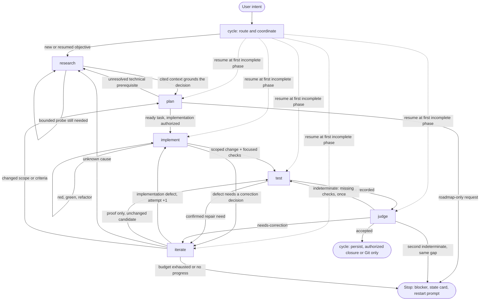

# How the Skills chain together

Use this map to see which Skill runs when, where each loop ends and which tools it may touch.

## Phase routing

Every phase verifies inputs and authority, works, integrates observations, then hands off
or stops. A phase-only request or an unpermitted next action ends with the result, a YAML
state card and a restart prompt. `task-authoring` edits ticket text, then returns to its caller.

## Loops and their bounds

| Loop | Bound | Counts as an attempt? |
|---|---|---|
| iterate → implement → test → judge | 3 authorized correction attempts per slice, unless the user sets another budget | Yes, recorded before dispatch; never reset |
| judge → test → judge (indeterminate) | One retry; a second indeterminate verdict on the same gap stops | No |
| iterate → research or plan (local replan) | Stops at a named deciding prerequisite; repeated speculation is not progress | No |
| research → research | One bounded probe at a time, within permissions | No |
| implement red → green → refactor | Internal to one slice; scope growth returns to the coordinator | No |

## What each Skill reads and uses

| Skill | Notable conditional reads | Tools it may use |
|---|---|---|
| cycle | Beads integration or initialization, authorization and review policy, requirements baseline, judgment rubric, candidate identity, state template | `bd`, branch/status inventory, delegation, observed session/checkpoint links if Entire is integrated |
| research | Delegated investigation, clarification interview, root-cause investigation, state of the art, reuse decision, knowledge pointers, readiness review | Workers: find files, analyze code, find patterns, optional state of the art; reproduction probes |
| plan | Requirements baseline, review policy, judgment rubric, plan readiness review | `task-authoring` for authorized ticket writes, `bd dep add`, readback |
| implement | Candidate identity, commit report | Project test runners; commit only with current authority |
| test | Test value, candidate identity | Project checks, `candidate_identity.py` capture/compare, browser capture for UI |
| judge | Judgment rubric, finding verification, candidate identity | Read-only reviewers, check replay |
| iterate | Candidate identity, review policy | Correction counter in tracker state; never edits code |

All phases share the delivery contracts and carry identical reference copies to stay portable.

## Tool calls and their gates

- **Beads:** `bd prime` only when context is missing or stale; check `bd where`
  if it prints nothing. `bd dep add A B` means A waits on B. `bd init` and
  `bd hooks` run only for authorized, controlled initialization.
- **Git:** `candidate_identity.py` reads `git rev-parse` and `git ls-files --stage`
  to freeze a candidate; `compare` returns 0 same, 1 different, 2 invalid.
  Commits need current authority; nothing pushes automatically.
- **Forge:** Skills never call `gh` or `glab`. Pull requests and publication follow
  [the contributor workflow](../CONTRIBUTING.md), outside the Skills.
- **Evaluation:** Skill Creator runs `node "$CREATOR" full-eval` only for a requested Skill evaluation.
- **Hooks:** Goose hooks run `observe.py` to report events; they never enforce or accept.

## Example: a review that lacks proof

1. Test records results but cannot run the browser check for one criterion.
2. Judge returns `indeterminate` and names the missing check and who can supply it.
3. Test runs that check once on the same frozen candidate; Judge reviews again.
4. A confirmed defect gives `needs-correction`: Iterate spends attempt 1 of 3 via Implement, Test, Judge.
5. If the check is still unavailable, the run stops with a restart prompt, not a loop.

## Questions that keep a run on track

| Moment | Question | Skill rule that answers it |
|---|---|---|
| Before planning | Is every blocking decision settled? | Clarification interview: one recommended-answer question per decision |
| Before coding | Which failing check proves each criterion? | Plan makes each behavioral task test-first with a criterion trace |
| During a bug fix | Is the cause confirmed, or only plausible? | Root-cause investigation: minimize, rank hypotheses, one variable per probe |
| Before counting a pass | Did any test get weaker? | Test lists deleted, skipped or loosened assertions in the candidate diff |
| Before acceptance | Who reviews, and on which frozen candidate? | Judge with plan-time independence; a repeated indeterminate verdict stops |

## Pitfalls to watch

- A run started at Research or Plan never finalizes; resume `cycle` to persist results.
- Loading a Skill grants no permission: commits, pushes, closure and installs need current authority.

For depth, read the [cycle entrypoint](../skills/cycle/SKILL.md) and the [cycle guide](cycle.md).
