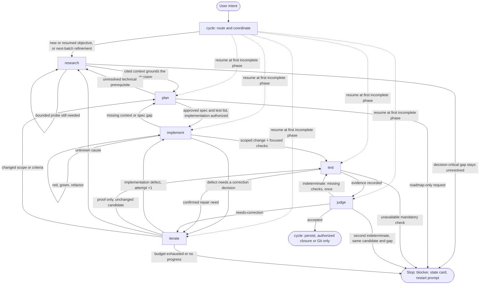

# How the Skills chain together

Use this map to see which Skill runs when, where each loop ends and which tools it may touch.

## Phase routing

Every phase verifies inputs and authority, works, integrates observations, then hands off or stops. A phase-only request or an unpermitted next action ends with the result, a YAML state card and a restart prompt.

**Optional capabilities:** `task-authoring` (ticket text) and `domain-modeling` (domain terms, decision records) are not phases: the workflow completes without them. Each loads when a request matches its description or when a phase's conditional Load step names it; if absent, the caller applies its contained guidance. Each returns to its caller and never chains into a phase.

## Order of work: specification, tests, then code

1. **Plan specifies, then lists the tests, before anyone codes.** Criteria with IDs and Given/When/Then, plus a written specification when several tasks or sessions share a story; each criterion names its failing check, seam and oracle, and each story one outer acceptance check. Plan stops for approval by you or a designated owner; Implement starts only from an approved specification.
2. **Implement writes one test right before its code; Test and Judge check that order.** The story's outer acceptance check fails first, stays marked pending, and passes last; inside it, red observed per criterion, minimal green, refactor inside the slice; a specification gap goes back to Plan. A proving check never shown to fail is an evidence gap, not proof.

## Loops and their bounds

| Loop | Bound | Counts as an attempt? |
|---|---|---|
| iterate → implement → test → judge | 3 authorized correction attempts per slice, unless the user sets another budget | Yes, recorded before dispatch; never reset |
| judge → test → judge (indeterminate) | One retry; a second indeterminate verdict on the same candidate and gap stops | No |
| iterate or plan → research (replan) | Stops at a named deciding prerequisite; repeated speculation is not progress | No |
| research grill mode (interview rounds) | Ends when no open decision remains and the user confirms the recorded decisions are complete; a deferred blocker stays a marker | No |
| research root-cause probes | Stop probing after three refuted hypotheses and report what would decide | No |
| research → research | One bounded probe at a time, within permissions | No |
| implement red → green → refactor | Internal to one slice; scope growth returns to the coordinator | No |

## What each Skill reads and uses

| Skill | Notable conditional reads | Tools it may use |
|---|---|---|
| cycle | Beads integration or initialization, authorization and review policy, requirements baseline, judgment rubric, candidate identity, state template | `bd`, branch/status inventory, delegation, observed session/checkpoint links if Entire is integrated |
| research | Delegated investigation, clarification interview (grill mode on request), root-cause investigation, state of the art, reuse decision, knowledge pointers, readiness review | Workers: find files, analyze code, find patterns, optional state of the art; reproduction probes; `domain-modeling` for disputed terms or decision records |
| plan | Requirements baseline, review policy, judgment rubric, specification template, plan readiness review | `task-authoring` for authorized ticket writes, `domain-modeling` for new or disputed terms and decision records, `bd dep add`, readback |
| implement | Candidate identity, test value, commit report | Project test runners, `candidate_identity.py`; branch, worktree or commit only with current authority |
| test | Test value, candidate identity | Project checks, `candidate_identity.py` capture/compare, browser capture for UI |
| judge | Judgment rubric, finding verification, candidate identity | Read-only reviewers, check replay, `candidate_identity.py` compare |
| iterate | Candidate identity, review policy | Correction counter in the tracker task, else a non-durable state card; never edits code |

Any phase may load `task-authoring`; Research and Plan may load `domain-modeling`; phases use `bd` when the repository uses Beads. Shared contracts are byte-identical per Skill so each installs alone; `requirements-output.md` is phase-specific.

## Tool calls and their gates

- **Beads:** `bd prime` only when context is missing or stale; check `bd where` if it prints nothing. `bd dep add A B` means A waits on B. `bd init` and `bd hooks` run only for authorized, controlled initialization.
- **Git:** `candidate_identity.py` reads `git rev-parse` and `git ls-files --stage` (`compare`: 0 same, 1 different, 2 invalid). Research runs `git bisect` only in a separate authorized worktree or clean checkout. Commits need current authority, per commit or through a standing Git autonomy grant. Cycle's optional integration-branch batch mode needs current authority for each branch, worktree, worker commit, merge or rebase and worktree removal. **Standing Git autonomy grant:** state it once instead of approving each commit. Level 0 (default) proposes commits. Level 1 commits each task after Test evidence, Judge `accepted` and closure readback, one commit per task with its ID. Level 2 also runs `git push` for the covered feature branch, fast-forward only. A grant names level, repository, epic or branch pattern, expiry and source, and never `develop` or `main`, default or release branches, force-push, tags, merges, pull requests, publication or Dolt sync. Example: *"Level 2 for this epic on `feature/*` until Friday."* A handoff only recalls a grant; revoke or narrow it at any time.
- **Forge:** Skills never call `gh` or `glab`. Pull requests and publication follow [the contributor workflow](../CONTRIBUTING.md), outside the Skills.
- **Evaluation and hooks:** Skill Creator runs `node "$CREATOR" full-eval` only for a requested Skill evaluation; Goose hooks run `observe.py` to report events; they never enforce or accept.

## Example: a review that lacks proof

1. Test records results but cannot run the browser check for one criterion.
2. Judge returns `indeterminate` and names the missing check and who can supply it.
3. Test runs that check once on the same frozen candidate; Judge reviews again.
4. A confirmed defect gives `needs-correction`: Iterate spends attempt 1 of 3 via Implement, Test, Judge.
5. If the check is still unavailable, the run stops with a restart prompt, not a loop.

## Questions that keep a run on track

| Moment | Question | Skill rule that answers it |
|---|---|---|
| Before planning | Is every blocking decision settled? | Clarification interview: one recommended-answer question per decision |
| Before coding | Is the specification approved and unchanged? | Plan records approver and links it from each task; Implement otherwise returns to Plan |
| Before coding | Which failing check proves each criterion? | Plan makes each behavioral task test-first; Implement confirms red fails on the expected assertion |
| During a bug fix | Is the cause confirmed, or only plausible? | Root-cause investigation: minimize, rank hypotheses, one variable per probe |
| Before counting a pass | Did any test get weaker? | Test lists deleted, skipped or loosened assertions in the candidate diff |
| Before acceptance | Was each proving check seen to fail? | Test confirms discrimination; Judge treats a never-failed check as a gap |
| Before acceptance | Who reviews, and on which frozen candidate? | Judge with plan-time independence; a repeated indeterminate verdict stops |

**Pitfalls:** a run started directly at a phase Skill never finalizes, so resume `cycle` to persist results; loading a Skill grants no permission for commits, pushes, closure or installs. For depth, read the [cycle entrypoint](../skills/cycle/SKILL.md) and the [cycle guide](cycle.md).
