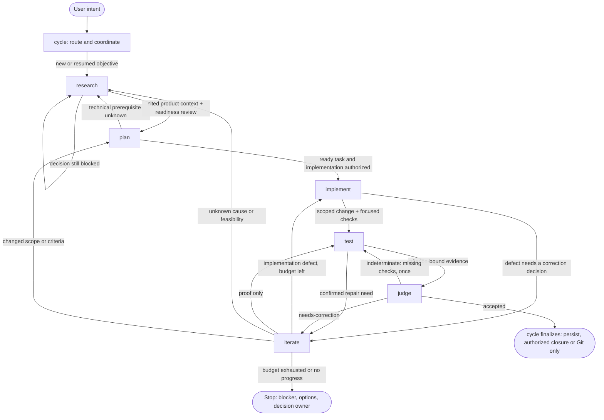

# How the Skills chain together

Use this map to understand which Skill runs when, what it reads and which tools it
touches, so you can spot a broken handoff, a duplicated rule or a missing step.

## Phase routing

Every phase ends in the same gate: if the request was phase-only, or the next action
is outside current scope or permissions, return the result, a YAML state card and a
restart prompt, then stop. `task-authoring` is loaded from any phase only to create or
repair ticket text; it returns to its caller after readback and never chains further.

## What each Skill reads and uses

| Skill | Notable conditional reads | Tools it may use |
|---|---|---|
| cycle | Beads integration or initialization, authorization and review policy, requirements baseline, judgment rubric, candidate identity, state template | `bd`, `git status`, Entire if integrated, delegation |
| research | Delegated investigation, clarification interview, root-cause investigation, state of the art, reuse decision, knowledge pointers, readiness review | Search and code analysis workers, authorized web research, reproduction probes |
| plan | Requirements baseline, review policy, judgment rubric, plan readiness review | task-authoring for ticket writes (when authorized), `bd dep add`, readback |
| implement | Candidate identity, commit report | Project test runners, `git` (commit only if authorized) |
| test | Test value, candidate identity | Project test commands, browser capture for UI |
| judge | Judgment rubric, finding verification, candidate identity | Read-only reviewers, check replay |
| iterate | Candidate identity, review policy | Correction counter in tracker state |

Every phase also applies the requirements baseline, authorization policy and review
policy before the actions they govern. All phases share the same delivery contracts
(common output, communication contract, phase output) and the optional `candidate_identity.py` CLI for exact-candidate proof.
Each Skill carries its own copy so it stays portable; copies must stay identical.

## Questions that keep a run on track

| Moment | Question | Skill rule that answers it |
|---|---|---|
| Before planning | Is every blocking decision settled? | Clarification interview: one recommended-answer question per decision |
| Before coding | Which failing check proves each criterion? | Plan makes each behavioral task test-first with a criterion trace |
| During a bug fix | Is the cause confirmed, or only plausible? | Root-cause investigation: minimize, rank hypotheses, one variable per probe |
| Before counting a pass | Did any test get weaker? | Test lists deleted, skipped or loosened assertions in the candidate diff |
| Before acceptance | Who reviews, and on which frozen candidate? | Judge with plan-time independence; a repeated indeterminate verdict stops |

## Pitfalls to watch

- A run started directly at Research or Plan never reaches finalization; resume
  `cycle` to persist results and perform authorized closure.
- Diagnosis, planning and waiting never increment the correction budget; Judge stops
  a repeated indeterminate verdict instead of looping through Test.
- Loading a Skill grants no permission: commits, pushes, closure and installs still
  need current, scoped authority.

For optional depth, read the [cycle entrypoint](../skills/cycle/SKILL.md) and the
[development cycle guide](cycle.md).
